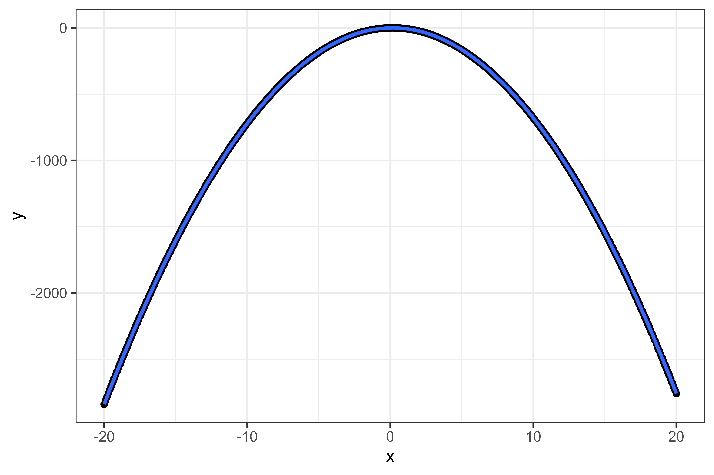

This is the first post in a Quarto blog. Welcome!




```{r}
library(ggplot2)

```


Let's say the function is:
$$ Q = L^{0.5}  $$

The we write it in such a way that R understands.


```{r}
f <- function(A, alpha, beta, L, K){
        A * (L^alpha) * (K^beta)
}
```


Then generate data set based in the function

```{r}

A <- 1
alpha <- 0.4
beta <- 0.6
L <- 0:30
K <- 20
Q <- f(A, alpha, beta, L, K)

data.frame(L = L,
           K = K,
           Q = Q) |> 
        ggplot(aes(L, Q)) + 
        geom_line(linewidth = 0.7, color = "blue") + 
        theme_bw() 

```


```{r}
# Define the production function with two inputs
production_function <- function(a, b, c, d, L, K) {
  # Calculate the output Q
  Q <- a * (L + K)^3 + b * (L + K)^2 + c * (L + K) + d
  # Return the output
  return(Q)
}

# Example usage:
# Coefficients: a = -0.1, b = 0.5, c = 1, d = 0
# Inputs: L = 10 (labor), K = 20 (capital)
a <- -0.1
b <- 0.5
c <- 1
d <- 0
L <- 0:6
K <- 1

# Calculate the output
output <- production_function(a, b, c, d, L, K)

# Print the output
print(output)

```


