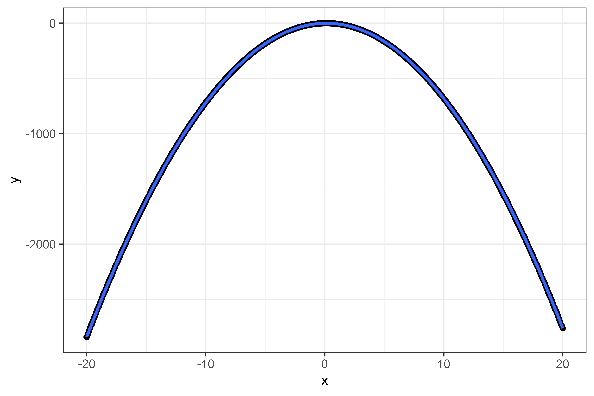

This is the first post in a Quarto blog. Welcome!




```{r}
library(ggplot2)

```


Let's say the function is:
$$ Y = -7x^2 + 2x  $$

The we write it in such a way that R understands.


```{r}
f <- function(x){
         -x^3+5*x^2-x
}
```


Then generate data set based in the function

```{r}
x <- seq(from = 0, to = 17, by = 0.1)


df <- data.frame(x = x,
                 y = f(x))

df |> ggplot(aes(x, y)) + 
        geom_line(linewidth = 0.7, color = "blue") + 
        theme_bw() 

```


