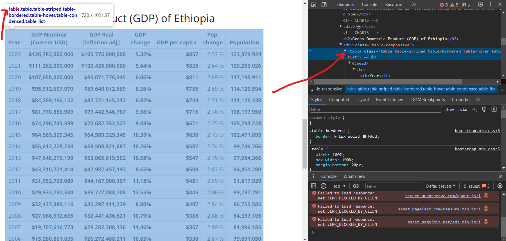

# What and why?

In this blog, we are going to import table from website into R. This is very important because it saves a time to copy the table manually and going through a lot of pain in excel to import the table into R. Doing it in that way is time consuming, tedious and prone to mistake. That's why `rvest` (harvest) package is there for you on CRAN. Install the package from CRAN using `install.packages()` function and let's dive in.

# Web Scrapping

First we need to have the url for the website from which we are planning to import the data as a dataframe in R. Here I am using Ethiopian GDP table from [worldmeters](https://www.worldometers.info/gdp/ethiopia-gdp/) website. Once we have the link to the website, we have to load the package and read html file from that page of website, which also contains the table of interest.


```{r}
# install.packages(rvest)         # Install the package if you do

library(rvest)

tbl_url <- "https://www.worldometers.info/gdp/ethiopia-gdp/"

raw_html <- read_html(tbl_url)


raw_html
```


The above HTML content contains two main parts: the head and the body. The body part of the document typically contains the content of interest. HTML documents are usually built using CSS, and the CSS selector helps us pick specific elements that we are interested in. To find the CSS of the element that we are interested in, right-click on the element of interest on the web and select inspect. Next, move your mouse over the codes in the Elements section until they highlight all parts of the table in blue. 

Then, you can view the CSS selector of the element, which in this case is the table. You can also use xpath instead of CSS to select an element, but let's keep it aside for a while. 


```{r}
 
element <- html_elements(raw_html, css = "table")
element
```

Once you select the element, it's still in HTML format and hard to understand. So, let's convert it into an R object. Now, we see that there are actually two table objects in the returned HTML.


```{r}
tables <- html_table(element)
tables
```

So, let's extract the one we are interested in, the second one. 


```{r}
gdp_tbl <- tables[[2]] 
gdp_tbl
```

## Cleaning the Data

After getting the data in R, the next step is to clean and perform the analysis we want.


```{r}
#| warning: false
#| message: false

gdp_tbl <- janitor::clean_names(gdp_tbl)


library(tidyverse)

glimpse(gdp_tbl)


```


```{r}
convert_to_numeric <- function(x) {
  as.numeric(str_remove_all(x, "[$,%\\s]"))
}

gdp_tbl <- gdp_tbl |> 
        mutate_all(convert_to_numeric)

glimpse(gdp_tbl)
```


```{r}
gdp_tbl |> 
        ggplot() + 
        geom_line(aes(x = factor(year), 
                      y = gdp_nominal_current_usd,
                      group = 1),
                  color = "blue", linewidth = 1) + 
        scale_y_continuous(labels = scales::dollar_format(scale = 1/1000000000,
                                                          suffix = " billion")) +
 
        labs(x = "Year",
             y = "Nominal GDP",
             title = "Ethiopia GDP (Nominal, $USD) 2003-2022",
             caption = "Source: https://www.worldometers.info/gdp/ethiopia-gdp/") + 
        theme_bw() + 
        theme(axis.text.x = element_text(angle = 45, vjust = 0.5))
```


```{r}
gdp_tbl |> 
        ggplot() + 
        geom_line(aes(x = year, y = gdp_change)) +
        geom_line(aes(x = year, y = pop_change)) + 
  theme_bw()
```


